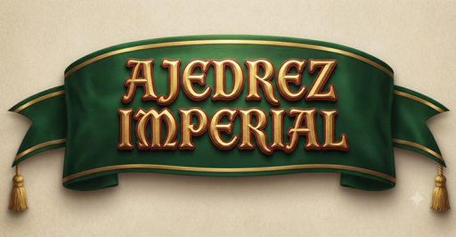
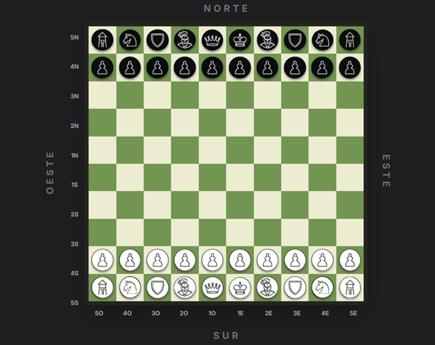
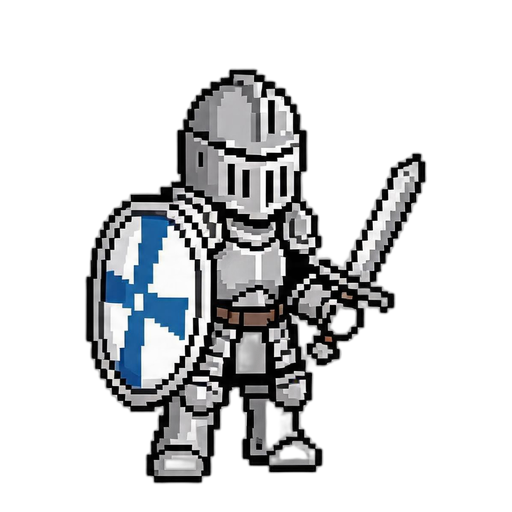
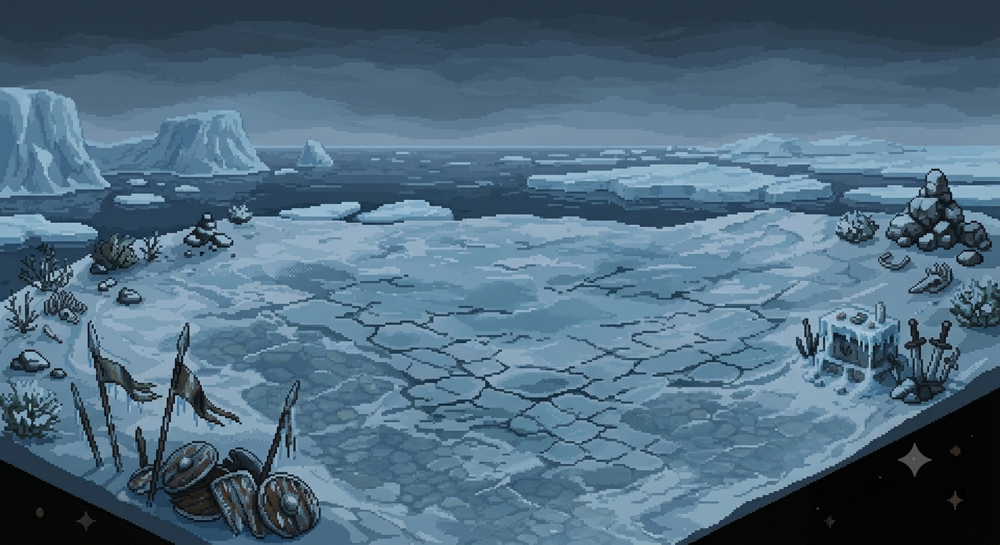
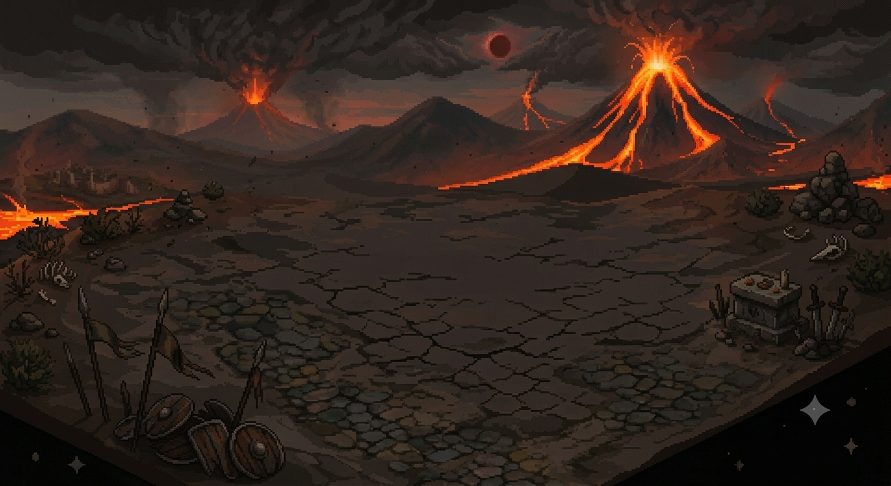
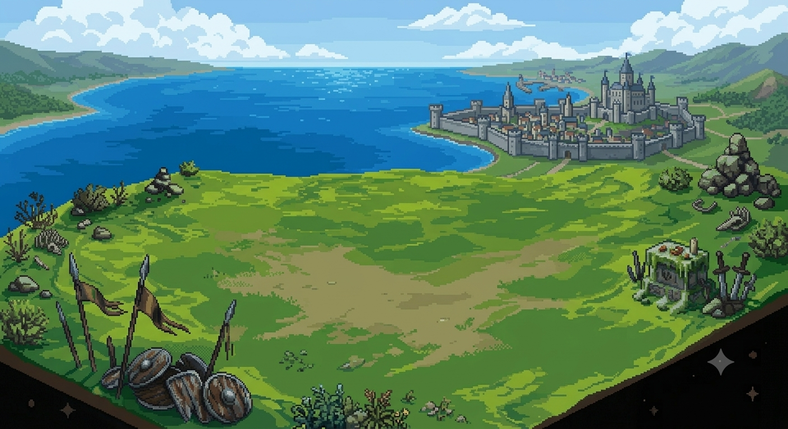

  
  
  ## 10x10 Tactical Chess — Open Core Engine

**Ajedrez Imperial** es una variante táctica y estratégica de ajedrez sobre un tablero extendido de 10x10. Fusiona la elegancia del ajedrez convencional con mecánicas avanzadas inspiradas en el shogi, que presentan un nuevo paradigma en el arte de la guerra sobre el tablero.

No es un simple juego de capturas; es un sistema de evolución constante, donde cada pieza tiene el potencial de transformarse en una versión más poderosa de sí misma. No se gana con ataques relámpago, sino con una gestión sofisticada de recursos, una planificación meticulosa de la evolución y una arquitectura defensiva que convierta tu retaguardia en una fortaleza impenetrable.

Esta versión demo web interactiva incluye un entorno de prueba de movimientos, un *Editor de Juego* para la creación de escenarios, modo multijugador local y un motor de Inteligencia Artificial (CPU) optimizado en JavaScript.

> (La versión Open Core incluye un editor reducido; la versión premium de **[itch.io](https://gonza-2907.itch.io/ajedrez-imperial)** ofrecera el editor completo con generación aleatoria).
 

## 🎯 El Modelo "Open Core"

Este repositorio contiene el **código fuente del motor de juego (Open Core)**, el sistema de reglas base y la documentación técnica. 

👉 **La experiencia completa** (gráficos 2.5D, modo editor, manual avanzado y 4 niveles de dificultad) está publicada de forma independiente en **[itch.io](https://gonza-2907.itch.io/ajedrez-imperial)**.

*   **GitHub:** Es la vitrina técnica y el punto de encuentro para desarrolladores y pruebas de concepto.
*   **itch.io:** Es el producto final pulido. Las donaciones y compras del Modo Editor/Manual Estratégico van destinadas a financiar la publicación en Google Play.

---

## 🎨 Galería de Arte y Diseño

*Un vistazo al diseño visual y la identidad de las piezas.*

### Personajes

  
  
  
  

### Escenarios

  
  
  

## ✨ Características Principales

* 🌐 **Soporte Bilingüe (ES / EN)**: Interfaz y documentación integradas en español e inglés (En desarrollo)
* ⚡ **Motor CPU Avanzado**: Optimización con Poda Alpha-Beta en el algoritmo Minimax para búsquedas más profundas, respuestas más rápidas y jugadas dinámicas.
* 🎨 **Editor de Tablero (Demo):** Herramienta ligera incluida en la demo de GitHub para colocar piezas, probar posiciones manualmente y exportar escenarios. La versión completa con generación aleatoria y más herramientas está disponible en la verison de [itch.io.](https://gonza-2907.itch.io/ajedrez-imperial)
* 🏰 **Mecánicas Evolutivas:** Sistema de promoción por Caza (Shogi) y por Territorio.
* 🛡️ **Enroque Imperial:** Creación de castillos defensivos (Anaguma, Yagura, Mino).

## 📖 Reglamento y Documentación

Para consultar la jerarquía militar completa, el movimiento de las unidades y las condiciones de victoria, accede a los documentos oficiales incluidos en este repositorio:

*   📜 **[Reglamento Oficial (Español)](./assets/docs/reglamento-ajedrez-imperial-es.pdf)**
*   📜 **[Official Rulebook (English)](./assets/docs/official-rulebook-imperial-chess-en.pdf)**

> 📘 *El **Manual de Estrategias Avanzadas** (aperturas, castillos y tácticas avanzadas) se ofrece como un extra premium en la página de itch.io para apoyar el desarrollo.*

## 🎮 Juega la Demo en Línea

Puedes probar la versión alfa directamente en tu navegador (compatible con PC y dispositivos móviles):
👉 **[Jugar Ajedrez Imperial Demo](https://haruki-24.github.io/Ajedrez-Imperial/)**

### Modos de Juego:

* Editor de Juego / Modo Práctica (Sandbox para Creadores)
* PVP local - Modo Humano vs. Humano (Multijugador Local)
* PVC - Modo Humano vs. CPU (Minimax con Poda Alpha-Beta)
* Editor de Tablero (Open Core): Coloca piezas, prueba movimientos manuales y guarda posiciones. Acceder al [**Editor**](https://haruki-24.github.io/Ajedrez-Imperial/editor.html)

## 🏗️ Arquitectura Técnica

El proyecto está desarrollado desde cero utilizando estándares web modernos (Sin frameworks pesados):

*   **Frontend:** HTML5, CSS3 (Tailwind CSS) y JavaScript Vanilla.
*   **Motor CPU (`cpu.js`):** Implementación del algoritmo **Minimax con Poda Alpha-Beta**. Esta optimización descarta ramas ineficientes del árbol de búsqueda, garantizando tiempos de respuesta óptimos.
*   **Lógica de Estado:** Representación del tablero 10x10 mediante matrices, validación de movimientos complejos (saltos, evoluciones y enroques).

*(Si eres desarrollador, puedes explorar el código del motor en la carpeta `js/` para ver la implementación del algoritmo).*

---

## 🚀 Apoya el Proyecto (Meta: Google Play)

Actualmente estoy recaudando **$25 USD** para habilitar la cuenta de desarrollador en Google Play y lanzar la versión móvil oficial de Ajedrez Imperial. 

Si te gusta el juego o te interesa el motor, puedes apoyar de las siguientes formas:
1.  **[Jugando y donando en itch.io](https://gonza-2907.itch.io/ajedrez-imperial)**.
2.  **Compartiendo el proyecto** con entusiastas de los juegos de estrategia.
3.  **Contribuyendo al código** o reportando issues en este repositorio.

---

## 🧪 Fase de Pruebas (Alpha Testing)

La demo en GitHub Pages sigue activa para recolección de métricas y sugerencias sobre:
*   **Balance Táctico:** Evaluación de aperturas y control fronterizo.
*   **Rendimiento:** Auditoría técnica de la Poda Alpha-Beta.
*   **UI/UX:** Fluidez en móviles.

Puedes abrir un **Issue** si encuentras algún bug en la versión demo.

---

## 📜 Licencia y Propiedad Intelectual

**Copyright © 2026 Gonzalo Costela (Haruki-24). Todos los derechos reservados.**

*   **Código Fuente (Open Core):** El código JavaScript del motor lógico y la representación del tablero se comparten con fines de portafolio, evaluación técnica y contribución comunitaria.
*   **Propiedad Intelectual del Juego:** El diseño del juego, la jerarquía de piezas, el nombre "Ajedrez Imperial", los recursos gráficos (arte de personajes, tableros) y el reglamento oficial son obra intelectual de su autor. 
*   **Queda estrictamente prohibida** la venta, distribución comercial o modificación del arte y las reglas sin el consentimiento explícito del autor.
* **Declaración de Asistencia de IA**: Para el desarrollo de este proyecto se utilizaron herramientas de Inteligencia Artificial Generativa como apoyo en la corrección, optimización y refactorización de código y documentación. Sin embargo, la idea original, las mecánicas de juego, la arquitectura del software y la supervisión final del producto son responsabilidad y autoría exclusiva del autor.

---

*Proyecto en desarrollo activo.*
